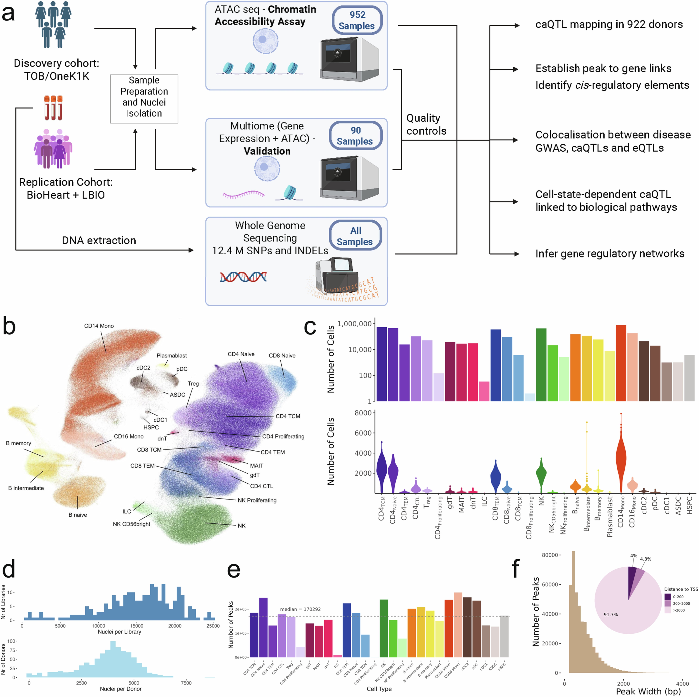

GWAS 发现的关联位点大多位于非编码区，这些位点究竟如何发挥作用，是基因组学长期关注的核心问题。过去十余年，研究者通常首先借助 eQTL 进行解释，即检验某个遗传变异是否改变了特定基因的表达水平。然而，eQTL 本身存在一个结构性的局限：它度量的是基因已经被转录出来多少，而在转录发生之前，染色质需要先处于开放状态。如果某个变异仅改变了调控开关的开合，而不显著影响稳态表达水平，或者其效应只在特定细胞状态下显现，那么仅凭 eQTL 往往难以捕捉到这类信号。

2026 年 10 月发表于 Nature 的这项研究（TenK10K 计划的 caQTL 部分，[原文链接](https://www.nature.com/articles/s41586-026-11173-4)），正是为了弥补这一不足而开展的系统性工作。

## 一句话总结

本研究主要完成了三项工作：构建千人规模的单细胞染色质可及性图谱，在此图谱上系统定位 caQTL，并利用 caQTL 解析 eQTL 难以解释的 GWAS 信号，进一步将新获得的遗传学证据应用于基因调控网络的推断。

## 背景一：chromatin accessibility peak 是什么

细胞核中的 DNA 并非裸露存在，大部分 DNA 缠绕在组蛋白上形成核小体。只有未被核小体占据、物理结构上较为松散的区域，转录因子与 RNA 聚合酶才能进入并结合，这类区域即具有染色质可及性（chromatin accessibility）的区域。从功能上看，这些开放区域大多对应启动子、增强子、绝缘子等调控元件。

将全基因组上的开放区域逐段识别出来，每一段即为一个 peak。因此，我们可以将一个 peak 粗略理解为一个候选调控元件。

## 背景二：peak 是怎么测出来的

本研究采用基于 ATAC-seq 的检测策略：利用经过改造的 Tn5 转座酶切割 DNA，并在切割的同时连接测序接头。由于 Tn5 更倾向于插入开放区域（这些区域没有核小体的阻挡），测序 reads 富集的位置即反映了染色质开放的位置。将 reads 比对回基因组后，若某一区间的 read 密度显著高于背景，即可判定为一个 peak。

其中有两个细节值得留意：第一，peak 是通过算法识别得到的，算法选择、细胞数量与合并策略都会影响 peak 的边界与总数；第二，reads 的富集反映的是可及性，而不等同于转录活性，一个 peak 处于开放状态，并不意味着其邻近基因正在活跃转录。

## 背景三：caQTL 是什么

caQTL 即 chromatin accessibility quantitative trait locus，也就是染色质可及性数量性状位点。如果群体中某个遗传变异的不同基因型会影响特定 peak 的开放程度，那么该变异即为一个 caQTL。

它与 eQTL 的区别可以这样理解：eQTL 描述的是从基因型到基因表达量的关联，而 caQTL 描述的是从基因型到染色质开放程度的关联。caQTL 位于调控链条的更上游，度量的是调控开关本身是否被打开。

同时需要说明的是，caQTL 本质上仍是一种统计关联，它表明某个位点的基因型与某个 peak 的开放程度在群体中显著相关，但并不直接等同于因果关系，也不能直接指出受影响的是哪个转录因子，后续还需要借助 motif 分析、序列预测模型或实验验证加以补充。

## 背景四：caQTL 是怎么推断出来的

尽管原始数据来自单细胞测序，关联检验并非在单个细胞层面逐一进行，而是采用了 pseudobulk（伪批量）策略：

1. 在同一细胞类型内，将同一个体所有细胞核在给定峰内的 fragment 计数加总，作为该个体的染色质可及性定量表型；
2. 采用 CPM（counts per million）归一化，并用 EDASeq 校正 GC 偏倚，随后转换为 Z-score；
3. 以该 Z 值对基因型进行线性回归，协变量包括性别、年龄、基因型主成分与可及性主成分；
4. 对每个峰，依次检验窗口内的全部变异，利用 TensorQTL 进行 10,000 次置换以获得经验 P 值，再按峰进行 FDR 校正；
5. 以 q < 0.05 筛选显著关联，这些位点即为 caQTL。

这里的单细胞分辨率主要体现在细胞类型层面：同一个峰在不同免疫细胞类型中可能对应不同的 caQTL。另一个值得注意的参数是 cis 窗口，本研究采用的是**峰中心上下游 1 Mb**，明显宽于常规 eQTL 常用的上下游 100 kb，这样设计的目的是为了覆盖远端增强子。

## 这篇文章的数据

| 维度 | 数字 |
| --- | --- |
| 供体 | 952 人完成 scATAC，质控后 922 人、3,472,552 个细胞核进入发现阶段 |
| 复制队列 | 90 人完成 multiome（RNA + ATAC），质控后 60 人专门用于复制验证 |
| 参照 scRNA | 5.4M 细胞、1,925 人，其中 932 人与 ATAC 数据重叠 |
| 细胞类型 | 28 个免疫细胞类型，采用 CITE-seq 进行 label transfer |
| peak | 440,996 个，各细胞类型独立识别后取 union |
| 基因型 | 每位供体均有 WGS 数据，而非插补基因型 |
| peak 形态 | 宽度 201 至 5,545 bp，中位 499 bp，仅 4.0% 落在 TSS 上下游 200 bp 内 |

最后一行数据值得进一步解读：中位宽度为 499 bp，且 96% 的 peak 位于 TSS 之外，说明这张图谱的主体是远端调控元件。这也解释了为何 cis 窗口需要放宽至 ±1 Mb，因为远端增强子与目标基因的距离常常达到数十甚至上百 kb。

此外，摘要中提到的超过 1042 人，是将 952 名 ATAC 供体与 90 名 multiome 供体合并计算的结果，实际进入发现阶段的是 922 人。

## 五步分析链

**第一步，建图。** 在每个细胞类型中独立识别 peak，合并为包含 440,996 个峰的 union 集合，再借助 CITE-seq 将细胞核归入 28 个免疫细胞类型。

**第二步，定量。** 按个体 × 细胞类型 × 峰进行 pseudobulk 加总，构建可及性矩阵，作为后续全部关联检验的输入。

**第三步，常见变异关联。** 限定 MAF 不低于 5%（约 9M 个 SNP 与 3.4M 个 indel），窗口取峰中心 ±1 Mb，采用 TensorQTL 置换检验，在 q < 0.05 下获得 243,225 个 caQTL，覆盖 100,483 个峰与 158,251 个独立 lead 变异，相当于 22.8% 的峰至少含有一个 caQTL。

**第四步，精细定位与验证。** 通过条件分析区分连锁的多个独立信号，并用 SuSiE 构建 credible set；验证包括三个层面：60 人 multiome 的内部复制（复制率为 82.5% 至 88.1%）、两项已发表 caQTL 研究的外部复制（复制率为 63% 至 95%，方向一致率为 78% 至 90%），以及等位特异分析的符号一致性（94% 至 100%）。研究还用 ChromBPNet 从序列出发预测效应量，峰内精细定位变异的预测值与观测值的相关性为 ρ = 0.75。

**第五步，下游整合。** 罕见变异（MAF < 5%，窗口 ±100 kb）采用 SAIGE-QTL 单独分析；通过 caQTL 与 eQTL 的共定位筛选候选顺式调控元件（cCRE）；再进一步开展 GWAS 共定位、细胞状态交互与基因调控网络三层分析。

## 结果

| 环节 | 主要结果 |
| --- | --- |
| 常见变异 caQTL | 243,225 个 caQTL，100,483 个 caPeak，覆盖 22.8% 的峰 |
| 细胞类型特异性 | 摘要报道约 60% 的 caQTL 仅在单一细胞类型中显著，正文表述为超过一半 |
| 罕见变异 caQTL | 216,159 个；去除常见变异可解释的部分后剩余 62,866 个、涉及 38,161 个峰 |
| cCRE | caQTL 与 eQTL 共定位获得 76,754 个事件、28,834 个峰、11,204 个基因 |
| GWAS | 在 16 种疾病与 44 个血液性状中，caQTL 相对 eQTL 平均多解释 9.8%（范围为 4.5% 至 22.6%），27.7% 的共定位位点仅见于单一细胞类型 |
| 疾病位点 | 炎症性肠病（IBD）中有共定位证据的位点比例由 16% 提升至 65% |
| 细胞状态 | 基因型与 CD4+ 细胞拟时序的显著交互共 209,189 个，其中 27.3% 未检出主效应 |
| 基因调控网络 | 将 caQTL 证据作为先验纳入后，新增 128 对 TF–靶基因（+22.4%），在 CRISPR 验证下的判别能力提升 17.2% |

以细胞状态这一层为例，可以更直观地看到新增的信息。ADCY7 附近有一个峰（chr16:50,326,863 至 50,327,752），邻近变异 16:50336792:G:C 与该峰的可及性相关，但效应方向依赖于细胞所处的状态：在 G/G 基因型的细胞中，该峰的可及性随拟时序上升，而在其他基因型的细胞中则呈现相反趋势。这类方向随状态翻转的效应，在 bulk 数据中容易因细胞状态被平均而消失。

## 局限性

- **peak 并非固定不变的特征。** 识别参数与细胞数量的变化都会影响峰的数量与边界，进而影响 caQTL 的结果，这是所有基于 peak 的 QTL 分析共同面临的局限。
- **cis 窗口是人为设定的。** 本研究采用 ±1 Mb，既有助于纳入远端增强子，也会带来更重的多重检验负担与连锁不平衡干扰，若改用 ±100 kb，结论可能有所不同。
- **覆盖范围限于静息外周血。** 研究采集的是静息状态下的免疫细胞，刺激后的应答状态与组织中的细胞状态尚未覆盖。
- **变异类型限于 SNP 与 indel。** 结构变异、串联重复等未纳入本次分析（同一批数据的串联重复由姊妹篇专门处理）。
- **细胞类型注释尚无金标准。** label transfer 的准确性会直接影响细胞类型特异性相关结论的可信度。
- **关联不等于因果。** 文中部分机制实例（如 CLEC2D 中破坏 ELF1 motif 的变异）有实验或 motif 证据支持，而 KLF2、ITGB2 两例作者已明确说明仅为与机制相符，尚不能视为直接证据。

总体而言，caQTL 并非要取代 eQTL，而是将从基因型到表型的链条向前推进了一步，补上了染色质开关是否打开这一环。对于从事 GWAS 后续解析的研究者，一个较为务实的做法是将其作为 eQTL 之外的第二类共定位证据，尤其适用于那些位于远端、超出常规 eQTL 窗口的位点。

## 参考资料

- Xue 等，Nature，2026：https://www.nature.com/articles/s41586-026-11173-4
- 同批数据的 eQTL 姊妹篇：https://www.nature.com/articles/s41586-026-10721-2
- 同批数据的串联重复姊妹篇：https://www.nature.com/articles/s41586-026-10438-2
- 原始数据（受控访问）：EGA EGAS50000001653、EGAS50000001654
- 汇总数据：Hugging Face `anglixue/TenK10K_multiome`
- 代码：https://github.com/powellgenomicslab/tenk10k_phase1_multiome
