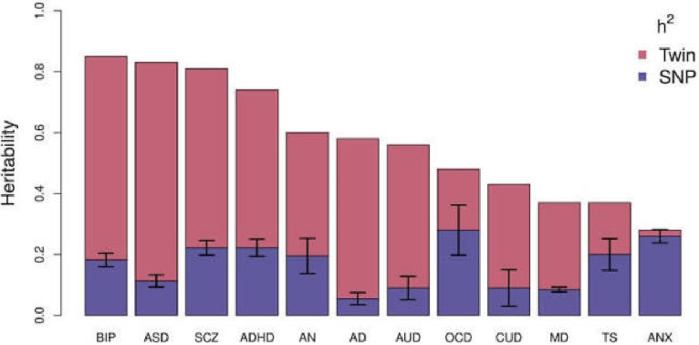

个体的表型通常同时受到遗传因素和环境因素的影响。**群体遗传率（heritability）**描述的是：在特定群体、特定环境和特定测量方式下，个体间表型差异中有多大比例可以归因于遗传差异。

这里的关键词是“群体中的差异”。遗传率不是某个个体的“表型有多少由基因决定”，也不是脱离群体和环境条件的固定常数。

为便于说明，设第 $i$ 个个体的表型为 $Y_i$，遗传因素对表型的贡献为 $A_i$，环境和测量误差合并为 $E_i$，则可以写成：

$$
Y_i = A_i + E_i
$$

若 $A$ 表示所有遗传效应（包括加性和非加性效应），广义遗传率可写为：

$$
H^2 = \frac{Var(A)}{Var(Y)}
$$

若只考虑加性遗传方差，则狭义遗传率通常记为 $h^2 = V_A/V_P$。不同研究设计估计的遗传率并不一定对应同一个方差组分。

在大规模基因测序普及之前，个体的遗传差异通常无法被直接测量，研究人员主要依赖双生子或家系设计进行间接估计。Falconer 公式和 Holzinger 公式就是其中较经典的两个方法。

## Falconer 公式：双生子法

双生子通常分为同卵（monozygotic, MZ）和异卵（dizygotic, DZ）两类。同卵双生子几乎共享全部分离基因，异卵双生子平均共享约一半的分离基因。

Falconer 方法比较两类双生子对在表型上的相似程度。对连续性状，常用的估计公式为：

$$
h^2 = 2(r_{MZ} - r_{DZ})
$$

其中，$r_{MZ}$ 和 $r_{DZ}$ 分别表示同卵和异卵双生子之间的表型相关系数。

### 线性模型下的遗传率与 Falconer 公式的关系

为了把 Falconer 公式和一般的遗传率定义联系起来，设第 $k$ 个个体的表型为：

$$
Y^{(k)} = \beta G^{(k)} + \epsilon^{(k)}, \qquad k=1,2
$$

其中，$G^{(k)}$ 表示个体的遗传值，$\beta G^{(k)}$ 是遗传因素对表型的贡献，$\epsilon^{(k)}$ 汇总环境影响和测量误差。令：

$$
V_G = Var(\beta G), \qquad V_P = Var(Y)
$$

并假设遗传效应与环境效应不相关，即 $Cov(\beta G,\epsilon)=0$。于是，群体遗传率可以写成：

$$
h^2 = \frac{V_G}{V_P}
$$

对于一对双生子，设两人的环境项协方差为：

$$
C = Cov(\epsilon^{(1)},\epsilon^{(2)})
$$

经典双生子模型假设 MZ 和 DZ 双生子的共享环境程度相同，因此这个 $C$ 在两类双生子中相同。另一方面，同卵双生子共享全部遗传值，异卵双生子平均共享一半的加性遗传值，因此：

- 对于 MZ 双生子，
  $$
  Cov(\beta G^{(1)},\beta G^{(2)}) = V_G
  $$

- 对于 DZ 双生子，
  $$
  Cov(\beta G^{(1)},\beta G^{(2)}) = \frac{1}{2}V_G
  $$

利用协方差的线性性质，并假设遗传效应与环境效应之间没有协方差，可以得到：

$$
r_{MZ}
= \frac{Cov(Y^{(1)}_{MZ},Y^{(2)}_{MZ})}{V_P}
= \frac{V_G+C}{V_P}
$$

$$
r_{DZ}
= \frac{Cov(Y^{(1)}_{DZ},Y^{(2)}_{DZ})}{V_P}
= \frac{\frac{1}{2}V_G+C}{V_P}
$$

两式相减后，共享环境项 $C$ 被消去：

$$
r_{MZ}-r_{DZ}
= \frac{\frac{1}{2}V_G}{V_P}
$$

因此：

$$
2(r_{MZ}-r_{DZ}) = \frac{V_G}{V_P} = h^2
$$

这就是 Falconer 公式与一般遗传率定义之间的联系。需要注意，原模型中的 $\epsilon$ 不能简单地把双生子间的协方差写成 $Var(\epsilon)$；一般应写成 $Cov(\epsilon^{(1)},\epsilon^{(2)})$。只有在两名双生子的环境误差被视为完全相同的时候，才可以将二者等同起来。该推导还依赖 MZ 与 DZ 双生子的共享环境程度相当、遗传效应采用加性模型，以及遗传与环境之间不存在系统性协方差或交互作用。

## Holzinger 公式

Holzinger 一致率公式常用于二分类表型的粗略比较，并以双生子对的一致率（concordance rate）为基础：

$$
h^2 = \frac{C_{MZ} - C_{DZ}}{1 - C_{DZ}}
$$

其中，$C_{MZ}$ 和 $C_{DZ}$ 分别是同卵和异卵双生子的一致率。直观上，分子表示同卵双生子相对于异卵双生子多出来的相似性，分母则对异卵双生子仍然存在的不一致空间进行标准化。

不过，这个公式不应被当作对二分类性状通用且严格的遗传率估计量。其结果会受到一致率定义、疾病患病率、抽样方式、诊断阈值和双生子对内部相关结构的影响。异卵双生子也不是“完全不共享遗传因素”的对照组，他们平均共享约一半的分离基因。实际研究中，通常应根据表型和抽样设计选择适当的阈值模型或方差组分模型。需要注意，文献中还存在以双生子相关系数而非一致率为基础、同样被称为 Holzinger 公式的表达式，引用公式时应明确所用版本。

Falconer 和 Holzinger 方法都依赖双生子研究设计，成本较高。对于患病率较低的疾病表型，也较难招募到数量充足且表型定义一致的双生子样本。

## GCTA-GREML 方法

Yang 等人提出的 GCTA-GREML 方法利用全基因组 SNP 数据估计 SNP 遗传率，从而减少对双生子或家系样本的依赖。GREML（genomic-relatedness-based restricted maximum likelihood）主要包含三个步骤：

1. **构建基因组关系矩阵（GRM）**：利用全基因组 SNP 数据，计算任意两个个体之间的遗传相似度。GRM 可以看作亲缘关系在基因组层面的估计。

2. **分解表型方差**：利用 GRM 将表型总方差 $V_P$ 分解为由观测 SNP 相似度所解释的遗传方差 $V_G$，以及未被 GRM 解释的剩余方差 $V_E$。后者包含环境影响、测量误差，以及未被基因分型数据捕获的遗传影响。

3. **REML 估计方差组分**：通过限制性最大似然法（REML）估计 $V_G$ 和 $V_E$，并计算 SNP 遗传率：
   $$
   h^2_{SNP} = \frac{V_G}{V_P}
   $$

GREML 可以聚合大量微效 SNP 的总体贡献，但它估计的是由所用 SNP 标记捕获的遗传方差，通常与双生子研究估计的广义遗传率不同。它需要个体层面的基因型数据，而这类数据往往受到隐私保护，难以公开获取。

## LDSC 方法

LDSC（linkage disequilibrium score regression）只需要 GWAS 汇总统计量（summary statistics），就可以估计 SNP 遗传率和遗传协方差。其核心思想是：在多基因模型下，包含更多连锁不平衡（LD）信息的 SNP，通常会有更大的 GWAS 统计量。

对第 $j$ 个 SNP，LD score 定义为它与其他 SNP 的 $r^2$ 之和。经典 LDSC 模型可写成：

$$
E(\chi_j^2 \mid L_j) = 1 + N a + \frac{N h^2_{SNP}}{M}L_j
$$

其中，$N$ 是 GWAS 样本量，$M$ 是用于建模的 SNP 数量，$a$ 汇总了群体分层、样本相关性等造成的统计量膨胀，$h^2_{SNP}$ 是由这些 SNP 捕获的遗传率。

因此，利用 GWAS 汇总统计量中每个 SNP 的 $\chi^2$ 统计量及其对应的 LD score 进行回归，可以通过回归斜率估计 SNP 遗传率：

$$
h^2_{SNP} = \frac{\text{回归斜率} \times M}{N}
$$

LDSC 的重要贡献是把遗传率估计从个体层面的基因型数据扩展到 GWAS 汇总数据，使研究人员能够复用大量公开结果，降低数据获取和计算门槛。

LDSC 仍然依赖多基因模型、合理的 LD 参考面板和质量较好的 GWAS 汇总统计量。模型假设遗传效应与 LD 结构之间满足特定关系；当因果变异与 LD、等位基因频率等因素的关系偏离模型时，估计可能出现偏差。对于样本量较小、遗传结构复杂或 LD 参考面板不匹配的数据，结果也可能不稳定。针对不同的遗传结构和统计效率需求，研究者还提出了 HDL、SumHer 等方法。

## 小结

这几类方法估计的并不是完全相同的量：

- **Falconer 和 Holzinger**：依赖双生子设计，通过 MZ 与 DZ 双生子的表型相似性差异间接估计遗传贡献；
- **GCTA-GREML**：使用个体层面的基因型数据，估计由所用 SNP 捕获的遗传方差；
- **LDSC**：使用 GWAS 汇总统计量，通过 GWAS 统计量与 LD score 的关系估计 SNP 遗传率。

因此，比较不同研究的遗传率结果时，除了看估计值本身，还应检查样本来源、表型定义、数据层级、模型假设，以及方法实际估计的遗传率类型。

