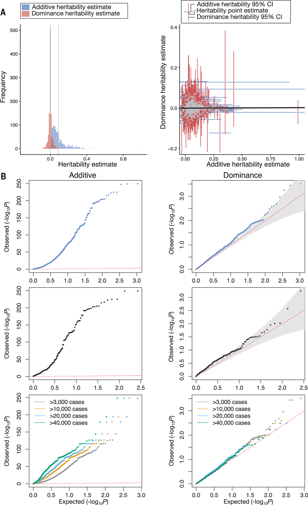

全基因组关联分析（GWAS）在进行关联检验之前，有一个重要的步骤是对基因型进行编码。目前，大多数 GWAS 采用加性模型（Additive model），例如将三种基因型 `aa`、`Aa` 和 `AA` 分别编码为 0、1 和 2。**加性模型**假设表型效应随风险等位基因的拷贝数线性变化，即每增加一个风险等位基因，表型效应便增加一个固定的量。

除此之外，遗传学中还存在**显性模型（Dominant model）**和**隐性模型（Recessive model）**两种经典的遗传模式：

- **显性模型**：假设风险等位基因 `A` 具有显性效应，个体只要携带一个风险等位基因，其表型效应就可以达到与风险等位基因纯合子相同的水平。例如，TAS2R38 基因中的功能性单倍型 PAV 相对于 AVI 单倍型通常表现出显性特征，携带至少一个 PAV 单倍型的个体通常具有苦味感知能力。不过，PAV/AVI 杂合子和 PAV/PAV 纯合子的苦味敏感程度仍可能存在差异。
- **隐性模型**：假设风险等位基因 `A` 具有隐性效应，其单个拷贝的效应会被正常等位基因 `a` 掩盖，只有当个体携带两个风险等位基因（纯合子 `AA`）时，相关表型才会明显表现出来。例如，欧洲人群的蓝眼性状与 *HERC2* 增强子区域的 rs12913832-G 等位基因密切相关，通常呈现近似隐性遗传模式：GG 基因型个体更容易表现为蓝眼，而 AG 和 AA 基因型个体通常表现为较深的眼睛颜色。不过，眼睛颜色本身是多基因性状，并非由单个位点完全决定。

除了基于加性、显性和隐性模型分别开展 GWAS 之外，如果对不同遗传模式分别进行关联分析和假设检验，会增加多重检验负担。为此，也有研究采用同时纳入两个基因型编码变量的方式，直接检验基因型与表型之间的整体关联。其中，比较常见的方式包括 **Codominant encoding（共显性编码）**和 **DOMDEV（Dominance deviation，显性偏离编码）**。

## 1. Codominant encoding（共显性编码）

Codominant 编码采用独热编码（One-hot encoding）的方式，以一种基因型作为参考组，使用两个 0/1 变量分别编码另外两种基因型，并在回归模型中同时估计杂合子（$\beta_{\mathrm{Het}}$）和风险等位基因纯合子（$\beta_{\mathrm{Hom}}$）相对于参考组的效应。

假设以正常等位基因纯合子 `aa` 为参考组，则：

$$
\begin{aligned}
Y_i & = \alpha + \beta_{\mathrm{Het}}G_{\mathrm{Het},i} + \beta_{\mathrm{Hom}}G_{\mathrm{Hom},i} \\
& \quad + \boldsymbol{\gamma}^{T}\boldsymbol{C}_i + \epsilon_i
\end{aligned}
$$

其中，$\boldsymbol C_i$ 表示协变量。

具体编码如下：

- 当个体基因型为 `aa` 时，$G_{\mathrm{Het},i}=G_{\mathrm{Hom},i}=0$；
- 当个体基因型为 `Aa` 时，$G_{\mathrm{Het},i}=1$，$G_{\mathrm{Hom},i}=0$；
- 当个体基因型为 `AA` 时，$G_{\mathrm{Het},i}=0$，$G_{\mathrm{Hom},i}=1$。

这种编码不对杂合子和纯合子的效应关系施加任何限制，因此可以灵活地捕捉不同遗传模式下的基因型效应。

## 2. DOMDEV（Dominance deviation，显性偏离编码）

DOMDEV 同样采用两个变量，但与 Codominant 编码不同，它以加性模型为基础，在加性效应之外，额外引入一个用于描述偏离加性遗传模式的显性偏离项。

具体回归模型为：

$$
\begin{aligned}
Y_i & = \alpha + \beta_A G_{\mathrm{Add},i} + \beta_D G_{\mathrm{DomDev},i} \\
& \quad + \boldsymbol{\gamma}^{T}\boldsymbol{C}_i + \epsilon_i
\end{aligned}
$$

这里，$G_{\mathrm{Add},i}$ 采用与加性模型相同的 0、1、2 编码方式；$G_{\mathrm{DomDev},i}$ 则只有当个体基因型为杂合子时才编码为 1，其余情况均编码为 0。

具体来说：

- `aa`：$G_{\mathrm{Add},i}=0$，$G_{\mathrm{DomDev},i}=0$；
- `Aa`：$G_{\mathrm{Add},i}=1$，$G_{\mathrm{DomDev},i}=1$；
- `AA`：$G_{\mathrm{Add},i}=2$，$G_{\mathrm{DomDev},i}=0$。

因此，当真实遗传效应符合纯加性模式时，显性偏离系数 $\beta_D=0$，模型便退化为加性模型。

这里需要强调，DOMDEV 不是简单地采用 0-1-0 编码进行单独的回归，而是将 0-1-0 的显性偏离项与 0-1-2 的加性项同时纳入模型。前者用于描述杂合子相对于加性预期的偏离。

它们具体的编码方式对比如下：

| **编码方式**     | **aa** | **Aa** | **AA** |
| ---------------- | ------ | ------ | ------ |
| Additive         | 0      | 1      | 2      |
| Dominant         | 0      | 1      | 1      |
| Recessive        | 0      | 0      | 1      |
| Codominant (Het) | 0      | 1      | 0      |
| Codominant (Hom) | 0      | 0      | 1      |
| DOMDEV (ADD)     | 0      | 1      | 2      |
| DOMDEV (DOMDEV)  | 0      | 1      | 0      |

## 3. Codominant 和 DOMDEV 之间的关系

Codominant 和 DOMDEV 都涉及两个变量，但它们实际上是同一个 2 自由度（2-df）基因型关联模型的不同参数化方式。两种模型中的回归系数可以相互转换：

$$
\beta_A = \frac{\beta_{\mathrm{Hom}}}{2}
$$

$$
\beta_D = \beta_{\mathrm{Het}} - \frac{\beta_{\mathrm{Hom}}}{2}
$$

其中，$\beta_D$ 可以理解为杂合子实际效应与加性模型预期效应之间的差异：

$$
\beta_D = \mu_{Aa}-\frac{\mu_{aa}+\mu_{AA}}{2}
$$

当 $\beta_D=0$ 时，杂合子的效应恰好处于两个纯合子效应的中点，符合加性遗传模式。

因此，两种编码虽然回归系数的含义不同，但整体的 2-df 关联检验是等价的。Codominant 更直接地描述不同基因型相对于参考组的效应，而 DOMDEV 则可以直接检验是否存在偏离加性遗传模式的效应。

## 4. DOMDEV 与遗传力估计

这里我觉得最有意思的是 DOMDEV 所代表的显性偏离思想：它在加性遗传效应的基础上，进一步刻画非加性遗传效应，从而可以研究加性和显性偏离对表型变异的不同贡献。

例如，Palmer et al. (2023) 在发表在 *Science* 上的研究 [Analysis of genetic dominance in the UK Biobank](https://pmc.ncbi.nlm.nih.gov/articles/PMC10345642/) 中，利用 UK Biobank 数据集（361,194 名参与者），系统分析了 1060 种表型的加性和显性遗传效应。

需要注意的是，该研究使用的 standardized dominance encoding 并不是简单固定的 0-1-0 编码，而是根据 SNP 的次要等位基因频率（MAF）进行标准化。在 Hardy-Weinberg 平衡假设下，其编码为：

$$
G_{\mathrm{Dom}} = \left[ -\frac{p}{1-p},\quad 1,\quad -\frac{1-p}{p} \right]
$$

其中，$p$ 为次要等位基因频率。这种编码使加性和显性偏离两个遗传成分在统计上具有正交性，有助于分别估计它们的遗传贡献。

此外，研究者还将显性偏离编码扩展到 LD score regression，提出了 dominance LD score regression（d-LDSC），用于估计全基因组范围内的显性 SNP 遗传力。

通过 UK Biobank 的分析，作者发现，在所研究的 1060 种表型中，加性遗传力仍然占据主导地位，而显性遗传力的整体贡献相对较小。这说明，尽管非加性遗传效应在某些位点和表型中具有重要作用，但对于大多数复杂性状而言，加性模型仍然能够解释相当大一部分遗传变异。

**Fig. 5. UK Biobank 中 1060 种表型的加性和显性遗传力比较。**
**(A)** 加性和显性 SNP 遗传力估计值的比较。左侧展示基于 LD score regression 得到的加性和显性遗传力估计值分布，右侧展示各表型的配对估计结果。
**(B)** 加性和显性遗传力的统计学证据比较。分别展示检验 $h_A^2\neq 0$ 和 $h_D^2\neq 0$ 的 Q-Q 图。上、中、下三行分别展示所有符合样本量要求的表型、连续及有序表型，以及二分类表型。

**参考资料**

1. Palmer, D. S., et al. (2023). [Analysis of genetic dominance in the UK Biobank. *Science*, 379, 1341–1348.](https://pmc.ncbi.nlm.nih.gov/articles/PMC10345642/)
2. [PLINK 2.0: Association analysis](https://www.cog-genomics.org/plink/2.0/assoc)
3. [TAS2R38 与苦味感知相关研究](https://pmc.ncbi.nlm.nih.gov/articles/PMC12258749/)
4. [HERC2 rs12913832 与眼睛颜色相关研究](https://pmc.ncbi.nlm.nih.gov/articles/PMC7485777/)
